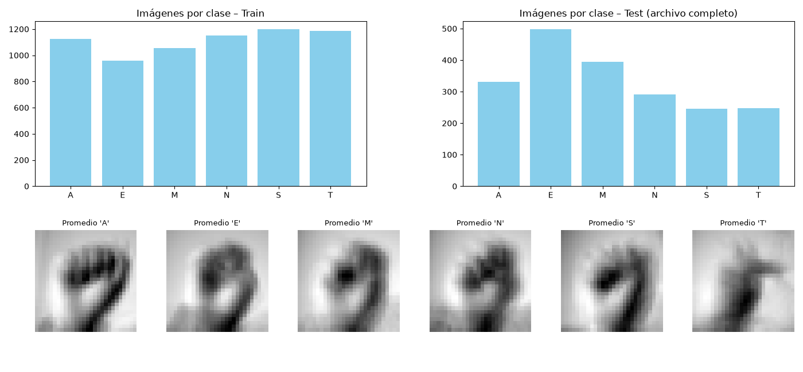
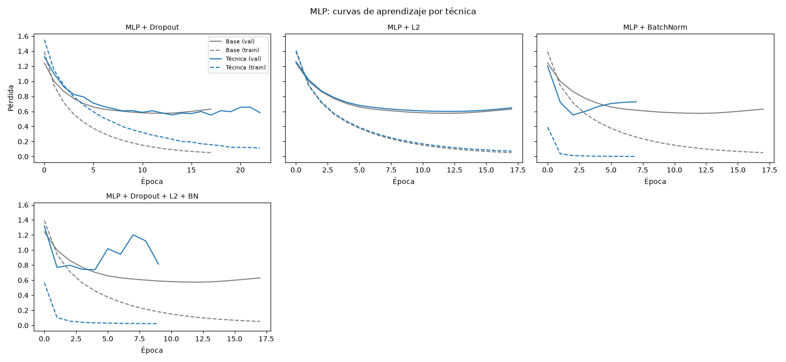
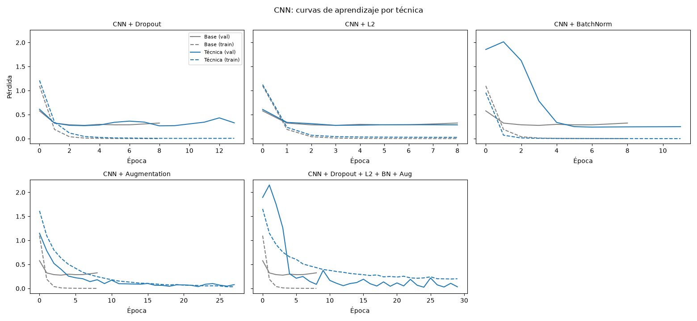
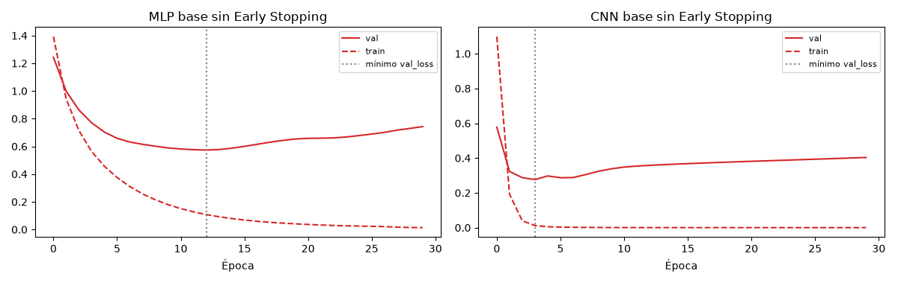
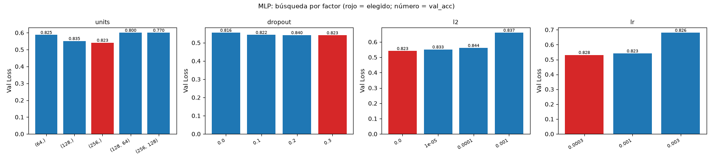
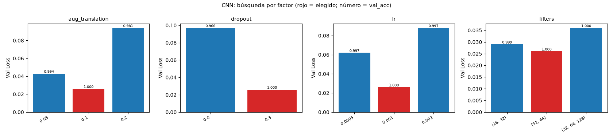
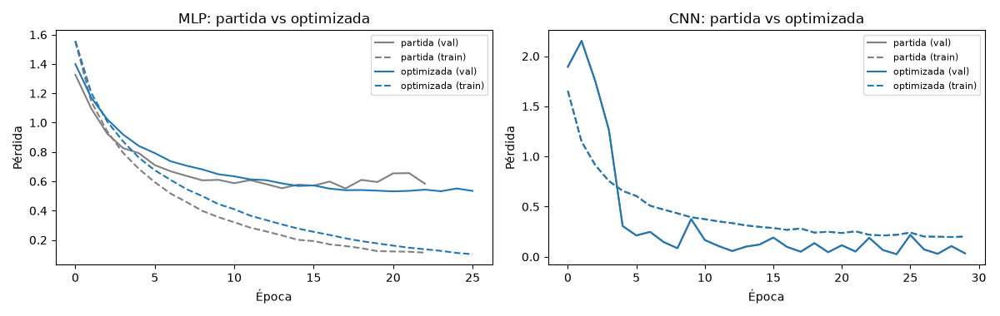
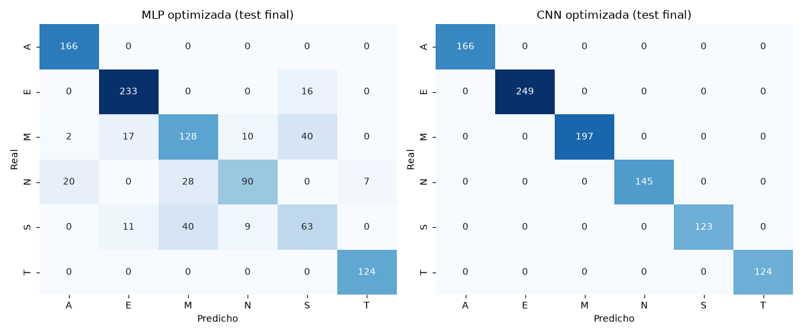
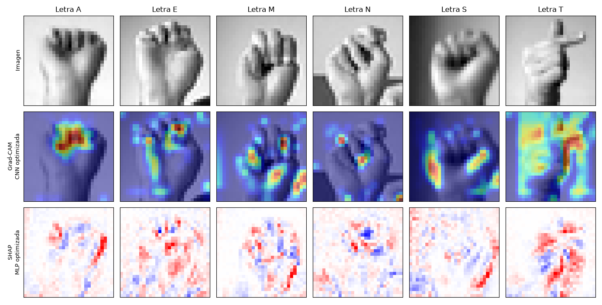
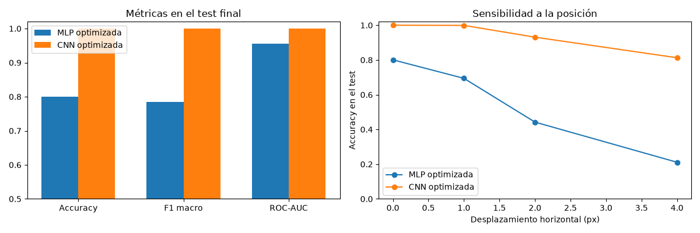

# Pipeline integrado de Deep Learning para clasificar letras de puño cerrado en lenguaje de señas (ASL): MLP vs CNN optimizadas
Evaluación Parcial N°3 – TLY1101 Técnicas Avanzadas de Machine Learning I

**Integrantes:** Bastian Sepulveda, Nicolas Bravo, Marcelo Obreque

Continúa la Evaluación Parcial N°1 (MLP, ver `train_sign.ipynb`) y la N°2 (CNN, ver `train_sign_cnn.ipynb`); sus informes están en el `README.md` de sus respectivas ramas: se resuelve el **mismo problema, con el mismo dataset, variante, split y semilla**, y se integra todo en un **pipeline** que regulariza, optimiza y audita una MLP y una CNN para compararlas objetivamente.

## Descripción del problema de negocio
Las personas con discapacidad auditiva enfrentan barreras de comunicación. Se busca un sistema de visión computacional que traduzca letras del alfabeto ASL a texto, facilitando la inclusión. Un sistema así solo es útil si acierta de forma pareja entre letras y en condiciones distintas (otras manos, fondos y cámaras): si rinde peor para ciertos usuarios, excluye justamente a quienes debería ayudar. Por eso, además del desempeño, esta evaluación **audita** los modelos (errores por clase, explicabilidad y sesgos).

## Objetivos
- Integrar en un pipeline modular las etapas de carga, EDA, preprocesamiento, modelo, entrenamiento, regularización, evaluación, optimización y auditoría.
- Aplicar y comparar técnicas de regularización (Early Stopping, Dropout, L2, Batch Normalization y Data Augmentation) y optimizar hiperparámetros con experimentos controlados.
- Auditar el comportamiento de la MLP y la CNN (métricas, matrices de confusión, Grad-CAM, SHAP y sesgos) y justificar con evidencia el modelo recomendado.

## KPIs
Los mismos de la EP1 y la EP2, fijados antes de entrenar y sin ajustarlos después de ver resultados.

| KPI | Meta | MLP (EP1) | CNN (EP2) | MLP optimizada (EP3) | CNN optimizada (EP3) |
|---|---|---|---|---|---|
| Accuracy | ≥ 80% | 79,4% (no cumplido) | 92,5% (cumplido) | 80,1% (cumplido, por margen mínimo) | **100,0% (cumplido)** |
| F1-Score macro | ≥ 75% | 0,784 (cumplido) | 0,917 (cumplido) | 0,784 (cumplido) | **1,000 (cumplido)** |

Un 100% en test indica **saturación**, no un modelo infalible (ver Auditoría).

## Fuentes de datos
Sign Language MNIST (Kaggle): https://www.kaggle.com/datasets/datamunge/sign-language-mnist. Archivos en `data/`.

**Variante propia (sin cambios respecto a la EP1 y la EP2, para mantener la trazabilidad):** solo las letras de puño cerrado o dedos recogidos (A, E, M, N, S, T), con el 100% de sus imágenes: 6.674 de train y 2.008 de test. Se distinguen casi solo por la posición del pulgar y la forma del puño.

## Preparación y EDA
- Sin nulos ni duplicados. Píxeles entre 0 y 255 (media 164,2). Train razonablemente balanceado (957 a 1.199 imágenes por clase, razón máx/mín 1,25); test **no** balanceado (246 a 498 por clase, razón 2,02), por lo que además del accuracy se reportan Precision, Recall, F1 macro y recall por clase.
- Normalización /255 y one-hot. Formato `(784,)` para la MLP y `(28, 28, 1)` para la CNN.
- **Validación independiente:** el train se usa solo para entrenar y el archivo de test (otras manos) se divide 50/50 estratificado (semilla 42): 1.004 imágenes de **validación** (Early Stopping y selección de modelos) y 1.004 de **test final** (solo se reporta). Limitación: el dataset no trae identificador de persona, así que las dos mitades podrían compartir manos.

## Metodología (CRISP-DM)
1. Comprensión del negocio (problema, objetivos y KPIs)  2. Comprensión de los datos (EDA)  3. Preparación de datos (normalización, one-hot, validación independiente)  4. Modelado (MLP y CNN, regularización y optimización de hiperparámetros)  5. Evaluación (múltiples métricas, matrices de confusión, XAI, sesgos y robustez, comparación MLP vs CNN)  6. Conclusiones / despliegue futuro (modelos guardados en `models/`; no se despliega en producción sin validar antes con manos, fondos y cámaras nuevos).

## Arquitectura del pipeline
Cada etapa es una función reutilizable y los experimentos solo cambian parámetros: `load_data` → `plot_eda` → `preprocess` → `build_mlp` / `build_cnn` → `train_model` (Adam, Early Stopping con `patience=5` sobre `val_loss`, máximo 30 épocas, 40 para la búsqueda de la CNN) → `evaluate_model` (Accuracy, Precision, Recall, F1 macro, ROC-AUC) → regularización (`dropout`, `l2`, `batch_norm`, `augment`) → `busqueda_por_factores` → auditoría (`gradcam`, SHAP). `run_experiment` construye, entrena y evalúa una configuración con la semilla fija (42).

**Trazabilidad con EP1 y EP2:** los modelos base se reentrenaron en este notebook. MLP base: 79,4% (referencia EP1: 79,4%). CNN base: 93,6% (referencia EP2: 92,5%, dentro de la tolerancia de ±2 puntos; la diferencia se atribuye al entorno de ejecución).

**Modelos finales (guardados en `models/`)**

| | MLP optimizada | CNN optimizada |
|---|---|---|
| Arquitectura | Dense(256, ReLU) → Dropout → Dense(6, softmax) | 2 × [Conv3×3 + BatchNorm + ReLU + MaxPool] (32 y 64 filtros) → Flatten → Dense(128) → Dropout → Dense(6, softmax) |
| Regularización | Dropout 0,3 | Dropout 0,3, L2 1e-4, BatchNorm y Data Augmentation (traslación 0,1, rotación 0,05, zoom 0,1) |
| Learning rate | 3e-4 | 1e-3 |
| Parámetros | 202.502 | 421.414 |

## Regularización
Cada técnica se aplicó **sola** sobre la línea base, más una combinación de todas (misma semilla, split y Early Stopping). **Criterio de selección fijado antes de ver resultados:** menor `val_loss` (desempate: mayor `val_acc`); el test final solo se reporta. La augmentation va solo en la CNN (la MLP aplana la imagen y pierde la estructura espacial); no se usa volteo horizontal porque cambiaría la seña.

| MLP | Val Loss | Val Acc | Brecha train–val | Test Acc |
|---|---|---|---|---|
| Base | 0,574 | 0,811 | 0,182 | 0,794 |
| + Dropout (0,3) | **0,551** | 0,835 | 0,128 | 0,812 |
| + L2 (1e-4) | 0,599 | 0,810 | 0,184 | 0,789 |
| + BatchNorm | 0,552 | 0,833 | 0,167 | 0,811 |
| + Dropout + L2 + BN | 0,739 | 0,772 | 0,228 | 0,780 |

| CNN | Val Loss | Val Acc | Brecha train–val | Test Acc | Tiempo (s) |
|---|---|---|---|---|---|
| Base | 0,276 | 0,921 | 0,079 | 0,936 | 46 |
| + Dropout (0,3) | 0,266 | 0,930 | 0,069 | 0,938 | 75 |
| + L2 (1e-4) | 0,276 | 0,926 | 0,074 | 0,929 | 46 |
| + BatchNorm | 0,240 | 0,945 | 0,055 | 0,942 | 85 |
| + Augmentation | 0,038 | 0,985 | −0,004 | 0,983 | 145 |
| + Dropout + L2 + BN + Aug | **0,026** | 1,000 | −0,075 | 1,000 | 237 |

- **MLP:** Dropout y BatchNorm mejoran de forma similar (gana Dropout por 0,001 de `val_loss`, casi un empate). L2 no aporta. Combinar las tres empeora. Ninguna técnica pasa de ~0,81: el límite parece estructural (aplanar pierde información espacial).
- **CNN:** la **Data Augmentation** es la técnica de mayor impacto (`val_loss` 0,276 → 0,038), a cambio de entrenar unas 3 veces más lento. La brecha negativa no es subajuste: el accuracy de entrenamiento se mide sobre imágenes ya transformadas.
- **Early Stopping:** sin él, la pérdida de validación sube tras su mínimo (MLP 0,574 → 0,743; CNN 0,276 → 0,403). En la CNN además baja el accuracy (0,936 → 0,918) y el entrenamiento se triplica (46 s → 149 s); en la MLP el accuracy no empeora.
- **Seleccionadas para optimizar:** `MLP + Dropout` y `CNN + Dropout + L2 + BN + Aug`.

## Optimización de hiperparámetros
**Grid Search por factor** (descenso por coordenadas, un hiperparámetro a la vez): se parte de la mejor configuración, se prueban todos los valores de un factor con el resto fijo y el ganador (menor `val_loss`) pasa a ser la configuración vigente. Un grid completo era inviable (240 entrenamientos para la MLP y 54 para la CNN). Limitación: no explora interacciones y puede depender del orden.

| Orden | MLP | CNN |
|---|---|---|
| 1 | `units`: (64), (128), **(256)**, (128,64), (256,128) | `aug_translation`: 0,05 · **0,10** · 0,20 |
| 2 | `dropout`: 0 · 0,1 · 0,2 · **0,3** | `dropout`: 0 · **0,3** |
| 3 | `l2`: **0** · 1e-5 · 1e-4 · 1e-3 | `lr`: 5e-4 · **1e-3** · 2e-3 |
| 4 | `lr`: **3e-4** · 1e-3 · 3e-3 | `filters`: (16,32) · **(32,64)** · (32,64,128) |

(En negrita, el valor elegido.)

- **MLP:** `val_loss` 0,551 → 0,531; las diferencias entre valores son pequeñas (≤ 0,02), salvo las redes de dos capas, que empeoran (0,600). Con 3 semillas (42, 7, 123) la MLP de partida logra 0,812 ± 0,002 de accuracy en test y la optimizada 0,810 ± 0,018: **no hay una mejora distinguible**.
- **CNN:** la configuración de partida resultó ser la mejor (ningún hiperparámetro cambió). Lo informativo es lo que empeora: traslación 0,20 (test 0,968), `dropout = 0` (0,967) y `lr = 2e-3` (0,996). Con (16,32) y (32,64,128) el resultado es casi igual (~0,999 a 1,000); a este nivel de saturación, diferencias de 1 a 8 imágenes no son concluyentes.
- El aporte vino de la **regularización**, no de afinar hiperparámetros.

## Resultados (test final, 1.004 imágenes)
| | MLP optimizada | CNN optimizada |
|---|---|---|
| Accuracy | 80,1% | **100,0%** |
| Precision macro | 0,788 | **1,000** |
| Recall macro | 0,786 | **1,000** |
| F1 macro | 0,784 | **1,000** |
| ROC-AUC (OvR macro) | 0,955 | **1,000** |
| Val Accuracy | 82,8% | **100,0%** |
| Brecha train–val | 0,143 | **−0,075** |
| Parámetros | **202.502** | 421.414 |
| Tiempo de entrenamiento (CPU) | **12,7 s** | 254,4 s |
| Épocas | 26 | 30 |
| Errores | 200 | **0** |

- **Por clase (recall MLP):** A 1,000; E 0,936; M 0,650; N 0,621; S 0,512; T 1,000. La CNN tiene recall 1,000 en todas.
- **Errores más frecuentes de la MLP:** M→S (40), S→M (40), N→M (28), N→A (20), M→E (17). Son puños cerrados que se distinguen por la posición del pulgar. La CNN no comete errores con este test.
- **Traslación horizontal (accuracy, 0/1/2/4 px, con `np.roll`):** MLP 80,1% / 69,4% / 44,2% / 21,1%; CNN 100% / 99,9% / 93,1% / 81,3%. Ambas dependen de dónde está la mano, la CNN mucho menos.
- **Grad-CAM (CNN):** en A, E, M, N y S la atención cae sobre dedos y nudillos (plausible); en la T es más difusa y en M, S y E aparecen focos en bordes o esquinas, pistas que no son la seña. **SHAP (MLP):** mapa disperso y ruidoso, sin forma de mano clara y con atribuciones en los bordes. Son 6 ejemplos: inspección cualitativa, no una prueba.
- Los tiempos dependen del hardware y los resultados pueden variar levemente según la versión de TensorFlow.

## Sesgos, implicancias éticas y modelo recomendado
| Fuente de sesgo | Evidencia | Mitigación |
|---|---|---|
| Pocas manos y sin ID de persona | Validación y test salen del mismo archivo (mismas manos): las métricas son optimistas y un ~100% no demuestra generalización | Split por persona y datos más diversos |
| Desbalance del test | Razón máx/mín 2,02 (E 498, S 246) | Reportar F1 macro y recall por clase; ponderar clases |
| Desempeño desigual por clase | MLP con recall 0,51 en S y 0,62 en N, frente a 1,000 en A y T | Modelo con estructura espacial, más datos o augmentation en clases difíciles |
| Dependencia de fondo y posición | Focos en bordes (Grad-CAM) y caída del accuracy al desplazar (CNN 1,000 → 0,813 a 4 px) | Augmentation más variado (recortes, fondo, iluminación) y pruebas con encuadres nuevos |

**Modelo recomendado: CNN optimizada.** Es mejor en todas las métricas y clases, más robusta a la posición, no sobreajusta (gracias a la augmentation) y su Grad-CAM es más legible que SHAP, lo que permitió detectar focos de atención fuera de la mano. A cambio, entrena unas 20 veces más lento y tiene el doble de parámetros. La MLP es una alternativa liviana que cumple los KPIs por un margen mínimo, pero es menos precisa y mucho menos robusta. **No debería usarse sin validar antes con manos, fondos y cámaras nuevos**: un reconocedor de señas es una herramienta de accesibilidad, y un modelo que falla más con ciertas personas o condiciones excluye justo a esos usuarios.

## Limitaciones y mejoras
Una sola semilla por configuración (salvo la confirmación de la MLP), búsqueda por factor sin interacciones, optimización que no mejoró a ninguna de las dos arquitecturas respecto a su punto de partida, validación y test sin separación por persona, solo 6 letras de 28×28 y prueba de posición con `np.roll`. Mejoras: validación con manos no vistas, augmentation más variado (brillo, fondo, recortes), búsqueda aleatoria o bayesiana con varias semillas, extender a las 24 letras estáticas, transferencia de aprendizaje y calibración de la confianza con abstención cuando sea baja.

## Estructura del proyecto
```
data/                      sign_mnist_train.csv, sign_mnist_test.csv
models/                    mejor_modelo_mlp.keras (EP1), mejor_modelo_cnn.keras (EP2),
                           mlp_optimizada.keras, cnn_optimizada.keras, hiperparametros_finales.json (EP3)
images/                    figuras (las de la EP3 empiezan con ep3_)
train_sign.ipynb           EP1 (MLP)
train_sign_cnn.ipynb       EP2 (CNN)
ep3_pipeline.ipynb         EP3 (pipeline integrado, MLP vs CNN optimizadas)
requirements.txt
README.md                  este informe (EP3)
```

## Reproducibilidad
Se recomienda **Python 3.12**, como en la EP1 y la EP2 (`tensorflow==2.21.0` no tiene versión instalable en Python 3.14 o superior: usar Python 3.12 o 3.13). Los resultados de este informe provienen de una ejecución de referencia, y los modelos incluidos en `models/` son los de esa ejecución. En otro equipo los resultados pueden variar alrededor de 1 punto porcentual (diferencias numéricas de CPU y librerías, aun con la misma semilla y versiones), sin cambiar las conclusiones; en esta evaluación se observó, por ejemplo, que la CNN base reproduce 93,6% contra el 92,5% reportado en la EP2.

```
pip install uv
uv venv --python 3.12 .venv
source .venv/bin/activate
uv pip install -r requirements.txt ipykernel shap
python -m ipykernel install --user --name ep3 --display-name "Python 3.12 (EP3)"
```
Ejecutar `ep3_pipeline.ipynb` de arriba a abajo desde la raíz del repositorio (semilla global = 42; las rutas `data/`, `images/` y `models/` son relativas). Las partes más lentas son los entrenamientos de la CNN con augmentation (de 1,5 a 5 minutos cada uno en CPU). El notebook reentrena las líneas base (MLP y CNN) para medir tiempos y verificar la trazabilidad con la EP1 y la EP2.

Referencias: Kaggle *Sign Language MNIST* (datamunge); Chapman et al. (2000) *CRISP-DM 1.0*; Selvaraju et al. (2017) *Grad-CAM*, ICCV; Lundberg y Lee (2017) *A Unified Approach to Interpreting Model Predictions (SHAP)*, NeurIPS; Srivastava et al. (2014) *Dropout*, JMLR; Ioffe y Szegedy (2015) *Batch Normalization*, ICML; Kingma y Ba (2015) *Adam*, ICLR.

## Figuras



















