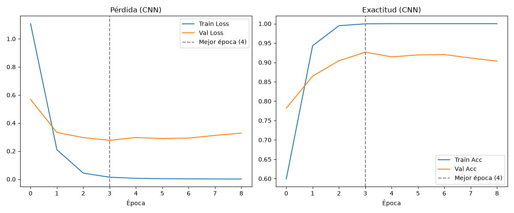
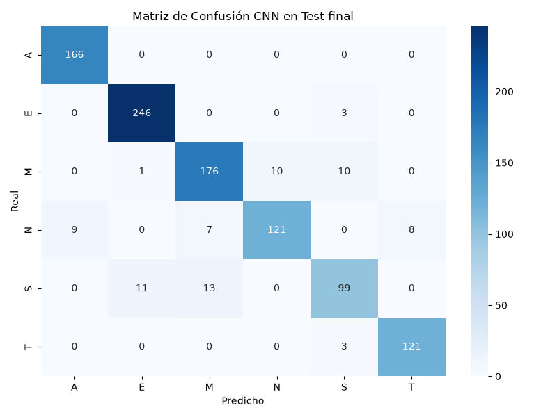
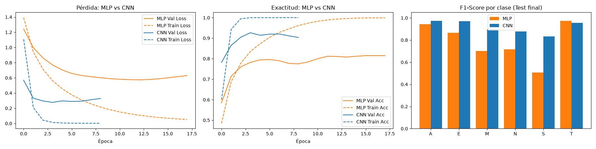
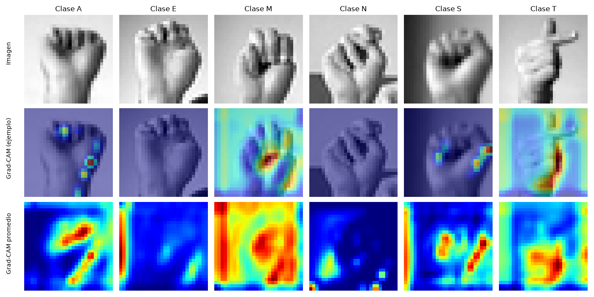
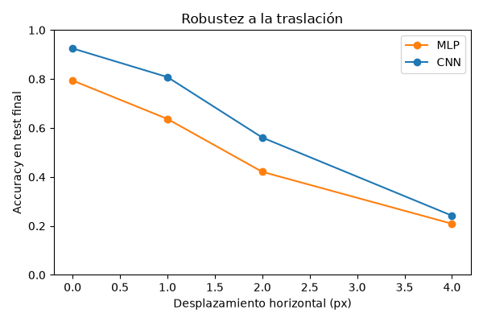

# Clasificación de letras de puño cerrado en lenguaje de señas (ASL) con CNN
Evaluación Parcial N°2 TLY1101 Técnicas Avanzadas de Machine Learning I

**Integrantes:** Bastian Sepulveda, Nicolas Bravo, Marcelo Obreque.

Continúa la Evaluación Parcial N°1 (MLP, ver `train_sign.ipynb`; su informe está en el `README.md` de la rama `main`): se resuelve el **mismo problema, con el mismo dataset, variante, split y semilla**, con una Red Neuronal Convolucional (CNN) para compararla objetivamente con el MLP.

## Descripción del problema de negocio
Las personas con discapacidad auditiva enfrentan barreras de comunicación. Se busca un sistema de visión computacional que traduzca letras del alfabeto ASL a texto, facilitando la inclusión.

## Objetivos
- Implementar, entrenar y evaluar una CNN que clasifique imágenes 28×28 en 6 letras ASL de puño cerrado: A, E, M, N, S, T.
- Comparar la CNN con el MLP Baseline de la EP1 (desempeño, parámetros, tiempo de entrenamiento y generalización).
- Interpretar los Feature Maps y mapas de activación (Grad-CAM) y analizar errores y limitaciones de ambas arquitecturas.

## KPIs
Los mismos de la EP1, fijados antes de entrenar y sin ajustarlos después de ver resultados.

| KPI | Meta | MLP (EP1) | CNN (EP2, test final) |
|---|---|---|---|
| Accuracy | ≥ 80% | 79,4% (no cumplido) | **92,5% (cumplido)** |
| F1-Score macro | ≥ 75% | 0,784 (cumplido) | **0,917 (cumplido)** |

## Fuentes de datos
Sign Language MNIST (Kaggle): https://www.kaggle.com/datasets/datamunge/sign-language-mnist. Archivos en `data/`.

**Variante propia (sin cambios respecto a la EP1, para mantener la trazabilidad):** solo las letras de puño cerrado o dedos recogidos (A, E, M, N, S, T), con el 100% de sus imágenes: 6.674 de train y 2.008 de test. Se distinguen casi solo por la posición del pulgar y la forma del puño, un detalle espacial que el MLP pierde al aplanar la imagen y que una CNN puede capturar.

## Preparación y EDA
- Sin nulos ni duplicados. Train razonablemente balanceado (957 a 1.199 imágenes por clase); test **no** balanceado (246 a 498 por clase), por lo que además del accuracy se reportan Precision, Recall y F1.
- Normalización /255 y one-hot (igual que en la EP1). **Cambio para la CNN:** las imágenes se entregan como tensor `(28, 28, 1)` y no aplanadas en 784 valores.
- **Validación independiente:** las imágenes del train son aumentaciones de pocas manos, por lo que el train se usa solo para entrenar y el archivo de test (otras manos) se divide 50/50 estratificado (semilla 42): 1.004 imágenes de **validación** (early stopping) y 1.004 de **test final** (reporte). Limitación: el dataset no trae identificador de persona, así que las dos mitades podrían compartir manos.

## Metodología (CRISP-DM)
1. Comprensión del negocio  2. Comprensión de los datos (EDA)  3. Preparación de datos (tensores 28×28×1)  4. Modelado (CNN)  5. Evaluación (métricas, matriz de confusión, comparación con MLP, Feature Maps, Grad-CAM, errores, traslación)  6. Conclusiones / despliegue futuro.

## Arquitectura de la CNN
Conv2D(32, 3×3, ReLU, same) → MaxPool(2×2) → Conv2D(64, 3×3, ReLU, same) → MaxPool(2×2) → Flatten → Dense(128, ReLU) → Dense(6, softmax). 421.126 parámetros. Pérdida `categorical_crossentropy`, optimizador Adam (lr 0,001), batch 64, máximo 30 épocas con early stopping (`patience=5` sobre `val_loss`). Los hiperparámetros y la capa Dense(128) son los mismos del MLP Baseline, para aislar el aporte de las capas convolucionales. Justificación completa en el notebook.

## Resultados (test final, 1.004 imágenes)
| | MLP Baseline (128) | CNN |
|---|---|---|
| Accuracy | 79,4% | **92,5%** |
| Precision macro | 0,782 | **0,920** |
| Recall macro | 0,790 | **0,916** |
| F1 macro | 0,784 | **0,917** |
| Val Accuracy / Val Loss | 81,1% / 0,574 | **92,6% / 0,277** |
| Brecha train–val | 0,182 | **0,073** |
| Parámetros | **101.254** | 421.126 |
| Tiempo de entrenamiento | **11,5 s** | 46,3 s |
| Mejor época (val_loss) | 13 | **4** |
| Errores | 207 | **75** |

- **Por clase (F1, MLP → CNN):** A 0,943 → 0,974; E 0,865 → 0,970; M 0,701 → 0,896; N 0,717 → 0,877; S 0,506 → 0,832; T 0,973 → 0,957.
- **Errores más frecuentes de la CNN:** S→M (13), S→E (11), M→S (10), M→N (10), N→A (9).
- **Traslación horizontal (accuracy, 0/1/2/4 px):** MLP 79,4% / 63,7% / 42,1% / 20,9%; CNN 92,5% / 80,8% / 56,1% / 24,2%. La CNN mejora al MLP, pero **no es robusta a la traslación** (sin aumentación de datos y con `Flatten` + `Dense`).
- **Grad-CAM:** zonas con sentido en T y M (pulgar), pero también activación en los bordes de la imagen en varias clases, lo que sugiere uso parcial del fondo o encuadre (no comprobado con un experimento específico).
- **Frente al MLP Profundo (256-128)**, que en la EP1 tuvo el mayor accuracy en test final: 81,5% de accuracy y 0,796 de F1 macro en este entorno (la EP1 reportó 83,4%; las diferencias entre MLP pequeños son sensibles al entorno numérico). La CNN lo supera por 9 a 11 puntos con cualquiera de los dos valores.
- El MLP se reentrenó en este notebook con la misma semilla y reproduce los resultados de la EP1. Los tiempos dependen del hardware y los resultados pueden variar levemente según la versión de TensorFlow.

## Limitaciones y mejoras
Sobreajuste (accuracy de entrenamiento 100%), clases S/N/M aún difíciles, falta de robustez a la traslación, posible dependencia del fondo, y validación y test sin separación por persona. Mejoras: Dropout, BatchNormalization, L2, aumentación de datos, `GlobalAveragePooling2D`, más capas convolucionales.

## Estructura del proyecto
```
data/                      sign_mnist_train.csv, sign_mnist_test.csv
models/                    mejor_modelo_mlp.keras (EP1), mejor_modelo_cnn.keras (EP2)
images/                    figuras (las de la EP2 empiezan con cnn_)
train_sign.ipynb           EP1 (MLP)
train_sign_cnn.ipynb       EP2 (CNN)
requirements.txt
README.md                  este informe (EP2)
```

## Reproducibilidad
Verificado con **Python 3.12** y las versiones exactas de `requirements.txt`. Los resultados de este informe provienen de una ejecución de referencia, y el modelo incluido en `models/` es el de esa ejecución. En otro equipo los resultados pueden variar alrededor de 1 punto porcentual (diferencias numéricas de CPU y librerías, aun con la misma semilla y versiones), sin cambiar las conclusiones. `tensorflow==2.21.0` no tiene versión instalable en Python 3.14 o superior: usar Python 3.12 o 3.13.

```
## Copiar y pegar todo

pip install uv
uv venv --python 3.12 .venv
source .venv/bin/activate
uv pip install -r requirements.txt ipykernel
python -m ipykernel install --user --name ep2 --display-name "Python 3.12 (EP2)"

```
Ejecutar `train_sign_cnn.ipynb` de arriba a abajo (semilla global = 42, ~2 min en CPU). El notebook reentrena el MLP Baseline para medir tiempos y carga `models/mejor_modelo_mlp.keras` como control.

## Figuras









